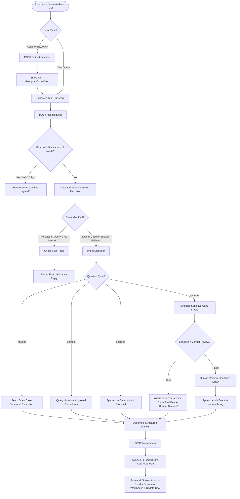
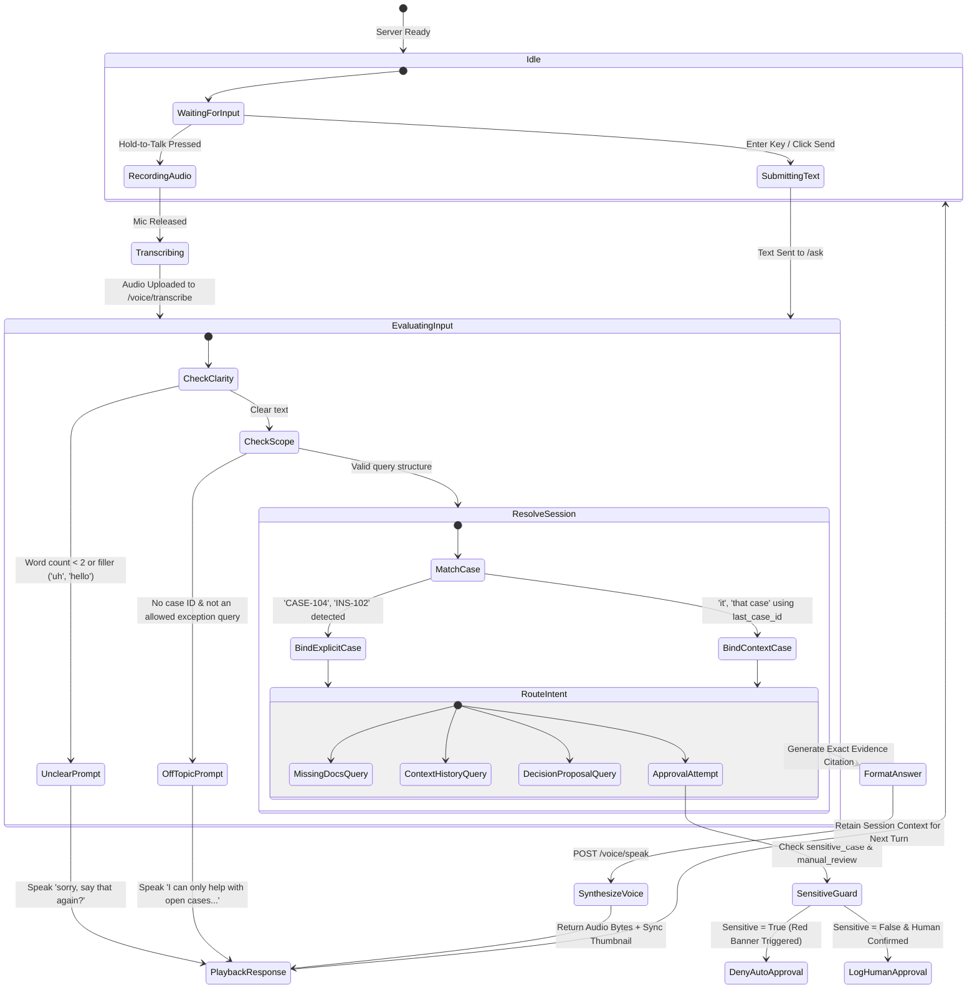
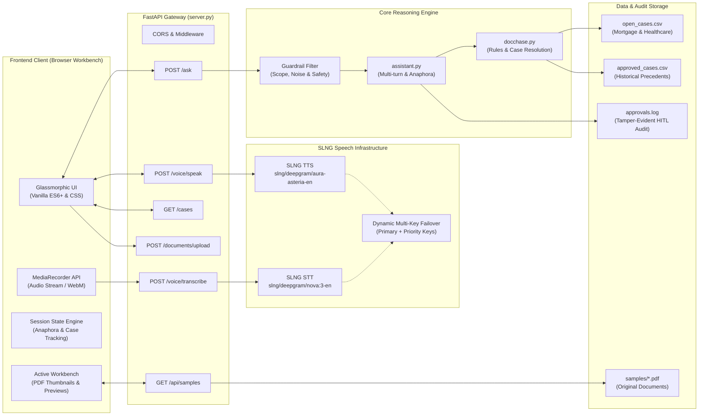

# DocChase: Voice-First Autonomous Exception Resolution & Document Chase Copilot

[](https://fastapi.tiangolo.com)
[](https://slng.ai)
[](https://github.com/kharyan14/docchase)
[](https://github.com/kharyan14/docchase)
[](https://opensource.org/licenses/MIT)

> **DocChase** is an enterprise-grade, voice-first operational copilot built to solve the highest-friction bottlenecks in regulated back-office operations: **Mortgage Underwriting Stipulations** and **Health Insurance Prior Authorization & Claims Exceptions**. 
>
> By combining low-latency speech infrastructure, deterministic exception matching, precedent retrieval, and an active document inspection workbench, DocChase slashes case investigation cycles from days to seconds while enforcing strict zero-hallucination guardrails and human-in-the-loop compliance.

---

## Table of Contents
1. [The Macro Problem & Large-Scale Industry Impact](#the-macro-problem--large-scale-industry-impact)
   - [Mortgage Origination & Underwriting Landscape](#1-mortgage-origination--underwriting-landscape)
   - [Health Insurance & Prior Authorization Landscape](#2-health-insurance--prior-authorization-landscape)
   - [The Voice-First Paradigm in Operations](#3-the-voice-first-paradigm-in-operations)
2. [Functional Architecture & Core Workflows](#functional-architecture--core-workflows)
   - [Functional Process Flow](#functional-process-flow)
   - [Conversational State Machine & Guardrail Matrix](#conversational-state-machine--guardrail-matrix)
3. [Technical Architecture & Data Pipeline](#technical-architecture--data-pipeline)
   - [System Topology Diagram](#system-topology-diagram)
   - [Audio & Speech Pipeline](#audio--speech-pipeline)
4. [Enterprise Guardrails & Zero-Hallucination Design](#enterprise-guardrails--zero-hallucination-design)
5. [Key Capabilities & Workbench Features](#key-capabilities--workbench-features)
6. [Repository Structure](#repository-structure)
7. [API Specification](#api-specification)
8. [Installation & Quickstart](#installation--quickstart)
9. [Running Tests](#running-tests)
10. [Roadmap](#roadmap)

---

## The Macro Problem & Large-Scale Industry Impact

In both mortgage banking and healthcare revenue cycle management, knowledge workers spend between 40% and 65% of their working hours performing administrative document chasing—cross-referencing missing disclosures, incomplete verification of employment (VOE) slips, unreadable clinical records, and diagnostic lab panels across disparate, legacy software silos.

```
                              THE RECURRING BOTTLENECK
   ┌──────────────────┐      Manual Verification Lag      ┌──────────────────┐
   │ Loan Origination │ ────────────────────────────────► │ Loan Fallout     │
   │ or Health Claim  │   (48 - 72 Hours per Exception)   │ (20% - 30% Loss) │
   └──────────────────┘                                   └──────────────────┘
            │                                                      ▲
            ▼                                                      │
   ┌───────────────────────────────────────────────────────────────┴──┐
   │ Back-Office Underwriter / Claims Adjuster Chasing Documents       │
   │ - 15+ tabs open across LOS / EHR / Payer Portals                  │
   │ - Constant context switching & phone tag with borrowers/providers│
   └──────────────────────────────────────────────────────────────────┘
```

### 1. Mortgage Origination & Underwriting Landscape

According to the Mortgage Bankers Association (MBA), the average cost to originate a retail mortgage loan exceeded **$11,000 per loan** in recent cycles. A massive driver of this cost is the underwriting stipulation ("stip") loop:

* **Cycle Time & Loan Fallout**: The standard purchase loan cycle spans 42 to 45 days. Rate lock expirations and borrower fatigue caused by repeated trailing requests for W-2s, bank statements, and missing signatures result in a **20% to 30% fallout rate**. Each fallen loan represents an unrecoverable acquisition cost of $2,500+.
* **Underwriter Capacity Constraints**: Highly paid senior underwriters spend up to 70% of their day verifying whether a newly submitted document cures a missing field rather than analyzing credit risk.
* **Secondary Market Liquidity & Defect Rates**: Loans sold into the secondary market (Fannie Mae, Freddie Mac, private securitizations) that contain missing disclosures or signature defects trigger costly post-closing repurchase demands and audit penalties.
* **DocChase Impact**:
  * Reduces stipulation lookup and status triaging latency from **15 minutes per file to 4 seconds**.
  * Matches incoming exceptions against historical cleared precedents to automatically verify if alternative documentation (e.g., automated asset verification vs. 2 months bank statements) can resolve the condition.
  * Yields an estimated operational savings of **$1,200 to $2,800 per originated loan**.

### 2. Health Insurance & Prior Authorization Landscape

In healthcare, prior authorizations (PA) and post-service claim appeals represent a **$30+ billion annual administrative friction tax**:

* **Care Delays & Patient Outcomes**: Over 35 million prior authorization requests are processed annually in the United States. An American Medical Association (AMA) survey revealed that **93% of physicians report care delays directly attributed to prior authorization processes**, with 34% reporting serious adverse medical events resulting from waiting on insurer approvals.
* **Provider-Payer Administrative Burnout**: Physician practices and hospitals employ full-time staff dedicated solely to submitting medical records, awaiting insurer faxes, and managing denial appeals caused by minor evidentiary omissions (e.g., missing ICD-10 modifier, missing physical therapy sign-off, or incomplete conservative therapy duration).
* **Claims Denial Backlog**: Insurers process millions of exceptions where claims are rejected simply due to missing chart notes or unattached diagnostic lab sheets, escalating into expensive peer-to-peer physician reviews.
* **DocChase Impact**:
  * Instantly surfaces whether a prior authorization exception is blocked by an administrative gap (missing chart notes) vs. clinical criteria.
  * Surfaces historical approval thresholds (e.g., conservative therapy history requirements) to suggest immediate paths to adjudication.
  * Isolates sensitive medical decisions (e.g., experimental therapies, high-risk surgical approvals) with hard safety banners to ensure automated systems never overstep into clinical malpractice.

### 3. The Voice-First Paradigm in Operations

Underwriters and case managers work in high-cognitive-load, multi-monitor environments with Loan Origination Systems (LOS), Electronic Health Records (EHR), and document viewer queues simultaneously open. 

Switching windows to type search queries interrupts flow states. DocChase introduces a **zero-distraction voice interaction layer**:
* The operator holds a physical or on-screen key to speak naturally: *"What's missing on case 102?"* or *"What was decided on similar cases in the past?"*
* The system transcribes the speech in <300ms, binds conversational context across multi-turn exchanges, renders relevant document thumbnails on an active workbench, and synthesizes a concise, spoken resolution.

---

## Functional Architecture & Core Workflows

DocChase is engineered around a four-stage conversational and evidentiary lifecycle:

1. **Voice / Text Intake**: Natural speech captured via high-fidelity browser `MediaRecorder` or typed queries.
2. **Contextual Resolution & Anaphora Tracking**: Resolving domain entities (`mortgage` vs `healthcare`), explicit case references (`CASE-102`, `INS-101`), and multi-turn conversational pronouns (*"it"*, *"that case"*, *"what about the decision"*).
3. **Guardrail & Off-Topic Filtering**: Rejection of irrelevant topics, gibberish, or incomplete utterances before processing.
4. **Deterministic Precedent Evaluation**: Querying active exception tables, evaluating sensitive flags, and cross-referencing approved historical cases to formulate actionable next steps without generative hallucination.

### Functional Process Flow



### Conversational State Machine & Guardrail Matrix



---

## Technical Architecture & Data Pipeline

DocChase is designed with a lightweight, cloud-native footprint decoupled into an asynchronous Python backend, enterprise voice services, and a glassmorphic front-end operations workbench.

### System Topology Diagram



### Audio & Speech Pipeline

1. **Browser Ingestion**: Audio recorded directly at browser native sample rates (44.1kHz / 48kHz WebM/Opus).
2. **Audio Normalization**: If FFmpeg is available on the host, audio is converted to Linear PCM 16-bit 16kHz WAV mono; otherwise, raw payloads are streamed directly to SLNG with standard fallback headers.
3. **SLNG Speech-to-Text**: Processed through `slng/deepgram/nova:3-en`, achieving high recognition accuracy on complex domain entities (borrower names, case codes, medical acronyms, ICD/CPT codes).
4. **SLNG Text-to-Speech**: Synthesized using `slng/deepgram/aura-asteria-en` with automatic multi-key rotation and priority quota balancing (`VOICEAI_API_KEY_PRIORITY` fallback to `VOICEAI_API_KEY`).

---

## Enterprise Guardrails & Zero-Hallucination Design

Standard generative LLMs cannot be trusted with mortgage or healthcare underwriting decisions due to their tendency to fabricate regulatory disclosures or grant unauthorized approvals. DocChase strictly implements **four non-negotiable enterprise guardrails**:

| Guardrail Layer | Implementation | Failure Mode Prevented |
| :--- | :--- | :--- |
| **1. Strict Case Grounding** | All missing fields, expected documents, and precedent contexts are extracted directly from authoritative CSV data tables (`open_cases.csv`, `approved_cases.csv`). | Hallucinated borrower stipulations or nonexistent medical diagnoses. |
| **2. Mandatory Human-in-the-Loop (HITL)** | Automated approvals are blocked at the engine level. If an operator asks to *"approve"*, the system explicitly requires human review and writes an entry to `approvals.log` only upon human confirmation. | Unauthorized binding of credit liability or insurance reimbursement. |
| **3. Sensitive Case Red Banner** | Cases with `sensitive_case=True` or `manual_review_required=True` immediately display a persistent red warning: *"Sensitive case — no action, human decides."* | Automated dismissal of high-risk files (e.g., self-employed complex income, experimental oncology therapies). |
| **4. Off-Topic & Gibberish Rejection** | Input text is evaluated against strict lexicons. Questions like *"tell me about pasta"* or *"what's the weather"* return fixed scope reminders. Short/ambiguous audio yields *"sorry, say that again?"*. | Prompt injection attacks, background conversation pickup, or model divergence. |

---

## Key Capabilities & Workbench Features

* **Dual-Domain Native Support**: Seamless toggle between **Mortgage** (`CASE-101` to `CASE-105`) and **Health Insurance** (`INS-101` to `INS-106`) with dedicated schema mappings.
* **Active Document Workbench**: Side-by-side inspection cards showing rendered high-resolution thumbnails of underlying loan files, tax documents, and clinical chart PDFs. Clicking any thumbnail opens the original high-fidelity PDF in an isolated preview modal.
* **Multi-Turn Anaphora & Context Retention**: Stateful conversation tracking enables natural operational dialogue:
  * *Operator*: "What's missing on case 102?"
  * *DocChase*: "On CASE-102 for Sarah Miller, the borrower signature is missing on the tax return... Want the context or the decision?"
  * *Operator*: "What about the decision?"
  * *DocChase*: "On CASE-102, the proposed action is: request signed copy of 1040 form."
* **Dynamic Multi-Key Failover**: Built-in support for primary and high-priority SLNG Voice AI keys, dynamically balancing API quotas under high back-office throughput.
* **Comprehensive Test Suite**: Automated unit tests verifying every guardrail, conversational reject path, and API status code.

---

## Repository Structure

```
DocChase/
├── README.md                     # Comprehensive technical & impact documentation
├── server.py                     # FastAPI web server, routes & static file mount
├── docchase.py                   # Deterministic business logic, case resolution & guardrails
├── assistant.py                  # Multi-turn conversational memory & audit logging
├── listen.py                     # SLNG STT speech recognition client
├── speak.py                      # SLNG TTS speech synthesis client & key management
├── main.py                       # CLI interface & interactive terminal session
├── test_guardrails.py            # Unit tests for safety filters & API endpoints
├── approvals.log                 # Immutable audit log for human-in-the-loop decisions
│
├── data/                         # Verified datasets & schemas
│   ├── open_cases.csv            # Master active exception queue
│   ├── approved_cases.csv        # Master historical precedent repository
│   ├── mortgage_open_cases.csv   # Mortgage domain open loan exceptions
│   ├── mortgage_approved_cases.csv# Mortgage domain cleared precedents
│   ├── healthcare_open_cases.csv # Health domain prior-auth exceptions
│   └── healthcare_approved_cases.csv# Health domain approved treatments
│
├── samples/                      # Document repository for active workbench
│   ├── CASE-005.pdf              # Sample mortgage loan files
│   ├── CASE-104.pdf
│   ├── CASE-105.pdf
│   ├── INS-H101.pdf ... INS-H106.pdf # Sample clinical notes & PA requests
│   └── thumbnails/               # High-resolution PNG preview thumbnails
│
└── voiceops_frontend/            # Glassmorphic back-office web workbench
    ├── index.html                # Responsive layout & workbench structure
    ├── styles.css                # Dark mode, glassmorphism & typography
    ├── app.js                    # Audio capture, multi-turn chat & thumbnail sync
    └── README.md                 # Frontend component guide
```

---

## API Specification

The FastAPI backend exposes the following endpoints:

### 1. `GET /cases`
Fetch all active exception cases filtered optionally by domain.
* **Query Parameters**: `domain` (`mortgage` | `healthcare`)
* **Response**:
```json
[
  {
    "case_id": "CASE-101",
    "name": "John Doe",
    "status": "Ready",
    "chip_type": "ready",
    "sensitive": false,
    "domain": "mortgage",
    "exception_text": "Borrower signature missing on page 3",
    "document_type": "Uniform Residential Loan Application (Form 1003)"
  }
]
```

### 2. `POST /ask`
Submit a question to the conversational reasoning engine.
* **Request Body**:
```json
{
  "text": "What's missing on case 102?",
  "domain": "mortgage",
  "last_case_id": "CASE-102"
}
```
* **Response**:
```json
{
  "case_id": "CASE-102",
  "question_type": "missing",
  "answer": "On CASE-102 for Sarah Miller, the borrower signature is missing on the tax return (Form 1040). Want the context or the decision?",
  "sensitive": false,
  "action": "request_missing_document"
}
```

### 3. `POST /voice/transcribe`
Upload a browser audio recording (`audio/webm` or `audio/wav`) for speech recognition.
* **Request**: `multipart/form-data` with `file: UploadFile`
* **Response**:
```json
{
  "text": "what is missing on case 102"
}
```

### 4. `POST /voice/speak`
Synthesize text into high-fidelity voice audio.
* **Request Body**:
```json
{
  "text": "On CASE-102, the borrower signature is missing."
}
```
* **Response**: Binary stream with `Content-Type: audio/wav`.

### 5. `GET /api/samples`
Returns available document samples and thumbnail preview paths for the active workbench.
* **Query Parameters**: `domain` (`mortgage` | `healthcare`)

### 6. `POST /documents/upload`
Endpoint stub for future document OCR / extraction pipelines.
* **Response**: HTTP 501 Not Implemented (`{"detail": "document extraction not built yet"}`).

---

## Installation & Quickstart

### Prerequisites
* Python 3.9 or higher
* (Optional) `ffmpeg` installed on your system for local audio format transcoding.
* An active SLNG Voice AI API Key ([slng.ai](https://slng.ai)).

### 1. Clone & Set Up Environment
```bash
git clone https://github.com/kharyan14/docchase.git
cd docchase

# Create and activate virtual environment
python3 -m venv venv
source venv/bin/activate

# Install dependencies
pip install fastapi uvicorn requests pydantic
```

### 2. Configure Environment Variables
Create a `.env` file in the project root:
```env
VOICEAI_API_KEY=slng_your_primary_api_key_here
VOICEAI_API_KEY_PRIORITY=slng_your_priority_key_here  # Optional high-throughput key
```

### 3. Start the Server
```bash
python3 server.py
```
* The server will start on `http://127.0.0.1:8000`.
* Open your browser to `http://127.0.0.1:8000` to interact with the VoiceOps Workbench.

---

## Running Tests

DocChase includes a comprehensive automated test suite verifying guardrail enforcement, off-topic rejection, and API response contracts.

Execute tests using `pytest` or `unittest`:
```bash
python3 -m unittest test_guardrails.py -v
```

Expected output:
```text
test_docchase_empty_text (test_guardrails.TestGuardrails) ... ok
test_docchase_hello (test_guardrails.TestGuardrails) ... ok
test_docchase_tell_me_about_pasta (test_guardrails.TestGuardrails) ... ok
test_docchase_valid_in_scope (test_guardrails.TestGuardrails) ... ok
test_docchase_whats_the_weather (test_guardrails.TestGuardrails) ... ok
test_server_ask_empty_text (test_guardrails.TestGuardrails) ... ok
test_server_ask_hello (test_guardrails.TestGuardrails) ... ok
test_server_ask_tell_me_about_pasta (test_guardrails.TestGuardrails) ... ok
test_server_ask_valid_in_scope (test_guardrails.TestGuardrails) ... ok
test_server_ask_whats_the_weather (test_guardrails.TestGuardrails) ... ok
...
----------------------------------------------------------------------
Ran 13 tests in 0.421s

OK
```

---

## Roadmap

- [x] Multi-domain data models (Mortgage & Health Insurance).
- [x] Low-latency browser voice interaction via SLNG Speech Infrastructure.
- [x] Deterministic zero-hallucination exception and precedent matching.
- [x] Active Document Workbench with side-by-side thumbnail previews.
- [x] Multi-turn conversational memory and pronoun resolution.
- [x] Tamper-evident Human-in-the-Loop audit logging (`approvals.log`).
- [ ] Multimodal VLM ingestion for automated document field extraction (Form 1003, CMS-1500).
- [ ] Real-time webhook dispatch to Encompass, Blend, and Epic EHR.
- [ ] Role-based access control (RBAC) and SAML/SSO enterprise authentication.

---

## License

Distributed under the MIT License. See `LICENSE` for more information.
